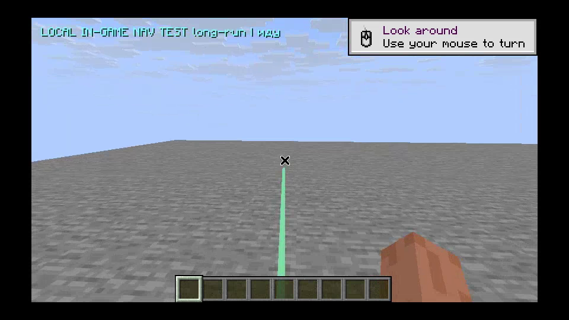
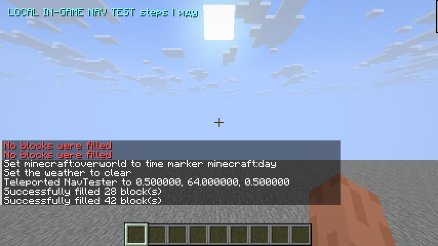

# Проверка Kaelix 1.18.0-dev

## Статус
Это dev-ветка навигации для подготовки работы с вредителями, **не законченная автоохота**. Стабильная 1.17.1 остаётся отдельной. Цель Minecraft 26.1.2, Fabric Loader 0.19.5, Fabric API 0.155.3+26.1.2, Loom 1.18.3, Java 25 / Gradle 9.7.1. API проверены по JAR целевой игры, не заимствованы из примеров 1.21.x.

## Сборка и чистые тесты
Выполнено без тестового профиля: `./gradlew clean build routeStress` → BUILD SUCCESSFUL (25 с в этой среде). Проверены version/entrypoints дистрибутива: нет NavClientTest и классов navtest.

Новые проверки: TrackingTurnCheck **96866**, GroundGuideCheck **51**, ReturnGuidedCheck **6654** на **60 полях препятствий** с клавиатурной инерцией и непрерывной камерой. Чистая симуляция не является точным движком Minecraft. Все прежние routeStress, в том числе полёт/кэш/маршруты/паника/оформление, прошли. Полный журнал: [results/build-routeStress.log](docs/navigation/results/build-routeStress.log).

## Фактический запуск Minecraft
Клиент Minecraft 26.1.2 и отдельный vanilla dedicated server, loopback 127.0.0.1:25567, offline NavTester с локальными правами команд. Linux, Corretto Java 25, Xvfb 960×540, окно 854×480, Mesa software rendering. Это реальный мир/коллизии/ввод/сетевая синхронизация, а не рендер мокапа.

Первый полный прогон: **12/12 PASS**. Повторный после правок снятия управления: **13/13 PASS**, с включённой отладочной геометрией со второго сценария и сменой GUI scale 2→3. Отдельный test entrypoint напрямую вызывает настоящий ReturnWalker; фермерский MacroManager не запускается. Поэтому это тест навигации, не всех детекторов/состояний фарма или фактической плашки MacroManager.

| Сценарий | Результат / статус контроллера | Тики | Ошибка XZ до цели, бл | Перестроения из-за препятствия |
|---|---|---:|---:|---:|
| Открытый участок | PASS / DONE | 92 | 0.109 | 0 |
| Стена и углы | PASS / DONE | 113 | 0.151 | 0 |
| Коридор 1 блок | PASS / DONE | 89 | 0.109 | 0 |
| Одиночное препятствие | PASS / DONE | 95 | 0.044 | 0 |
| Последовательные препятствия | PASS / DONE | 110 | 0.126 | 0 |
| Участок с платформами (обход разрешён) | PASS / DONE | 116 | 0.132 | 0 |
| Тупик (ожидаемый стоп) | PASS / FAIL | 1 | 15.000 | 0 |
| Перекрытие пути на ходу | PASS / DONE | 127 | 0.173 | 1 |
| Подход и остановка | PASS / DONE | 91 | 0.109 | 0 |
| Телепорт (ожидаемая отмена) | PASS / FAIL | 27 | 11.225 | 0 |
| Изменение координат цели | PASS / DONE | 99 | 0.008 | 0 |
| 8 последовательных отрезков | PASS / DONE | 697 | 0.155 | 0 |
| Смерть (ожидаемая отмена) | PASS / FAIL | 26 | 10.295 | 0 |

Дополнительно усилен сценарий высоты: цель поставлена на верхнюю платформу X=9.5, Y=66 (старт Y=64). Проверяется не только XZ, но и высота игрока с допуском 0.65 блока. **Отдельный фактический прогон PASS: 69 тиков, XZ-ошибка 0.020 блока, 0 перестроений**. Пройти вокруг по земле и получить PASS нельзя. Этот запуск также проверил штатные задачи `-PnavTest runServer/runClient` и восстановление локального тестового игрока после смерти предыдущего прогона. Результат: [mandatory-height-mc26.1.2.txt](docs/navigation/results/mandatory-height-mc26.1.2.txt).

Для тупика, телепорта и смерти PASS означает ожидаемый безопасный отказ, а не достижение цели. У смены координат цели вызывается API updateGoal; этот отдельный перезапуск не считается в счётчике аварийных replans. Большая мгновенная скорость в строке teleport-cancel — тестовая серверная телепортация, не скорость ходьбы.

Длительный сценарий здесь — восемь последовательных целей, 697 тиков (~35 секунд при 20 TPS), не многочасовой прогон. В конце каждого отрезка ожидается остановка и конечный поворот. 213 idle ticks включают поиск/выравнивание/остановки между этими целями; по этому тесту нельзя обещать полностью непрерывный проход любого маршрута.

Отладочные ленты/направление фактически отображались; ошибок Guard visual/navigation в этом прогоне нет. Разрешение окна одно, GUI scale два: произвольные разрешения/ресурспаки/рендер-моды не проверены. Количественного сравнения FPS/TPS или качества мыши с видео v4.0 нет. Запись 12 fps ограничивает оценку микроплавности; контроллер отдельно проверяется при 20/30/60/144/240 fps в stress.

Сырые результаты: [local-mc26.1.2.txt](docs/navigation/results/local-mc26.1.2.txt), [первый прогон](docs/navigation/results/first-pass-mc26.1.2.txt). Воспроизведение: [LOCAL-TEST.md](docs/navigation/LOCAL-TEST.md).

## Предупреждения и непроверенное
- При массовой начальной загрузке чанков был WARN RejectedExecutionException старого bounded-кэша (очередь 32). Игра/навигация не упали; часть фоновых снимков в этот момент пропускается и обновляется при последующих событиях/периодическом refresh. Это не доказательство, что весь мир сохранён, и не устранённая здесь задача оптимизации записи.
- В Linux-среде отсутствовала libflite для narrator; offline-профиль не получал Realms/profile key. Это ограничения тестового окружения, не ошибки навигации. Sodium не установлен: его совместимость не проверялась.
- Нет практической проверки Hypixel Garden, пестов, Vacuum/Lasso, реального движения цели-сущности, дальности/наведения/подтверждения убийства.
- Смена измерения/объекта мира и потеря игрока обрабатываются кодом отмены, но отдельно в этом игровом прогоне не воспроизводились. Проверены крупный серверный телепорт и смерть.
- Новая локальная навигация только наземная; sprint выключен как раньше. Полёт/лестница/прыжок/падение — сохранённые специальные контроллеры, не полноценная новая система.
- Новая физика, entity avoidance и гарантия античита/«неотличимости от человека» не заявлены. Нужен тест пользователем в своём окружении.

## Изменённые компоненты
TrackingTurn, SmoothTurn; GroundProbe, GroundGuide, ReturnCore, ReturnWalker; PathFinder, PathLevel, CachedPathWorld, PathJob; ModConfig, CustomizationRows, FarmHud, RouteRenderer; чистые stress-классы и opt-in src/navTest; документы/ПЛАНЫ/новости и подпись загрузки.

Причины/алгоритмы/приоритеты: [ARCHITECTURE.md](docs/navigation/ARCHITECTURE.md). Референсы: [REFERENCES.md](docs/navigation/REFERENCES.md). Дальнейшая работа над пестами выделена в ПЛАНЫ.md; эта версия не закрывает весь запрос об автоохоте.

## Кадры фактической проверки

